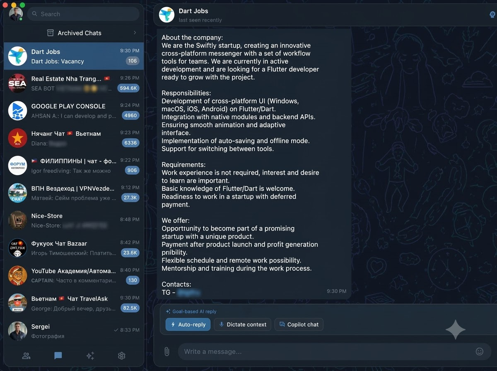
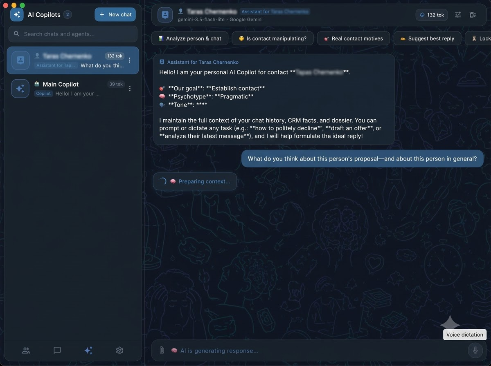
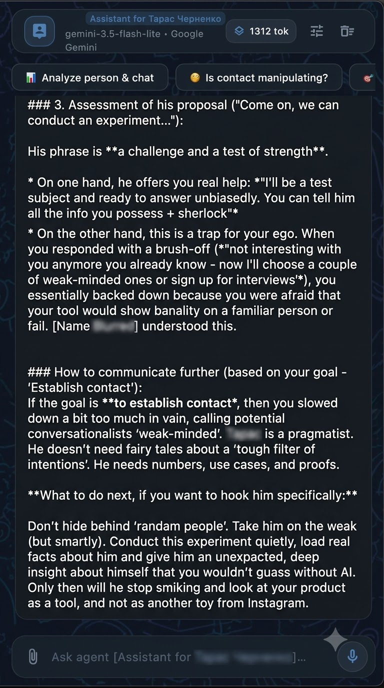
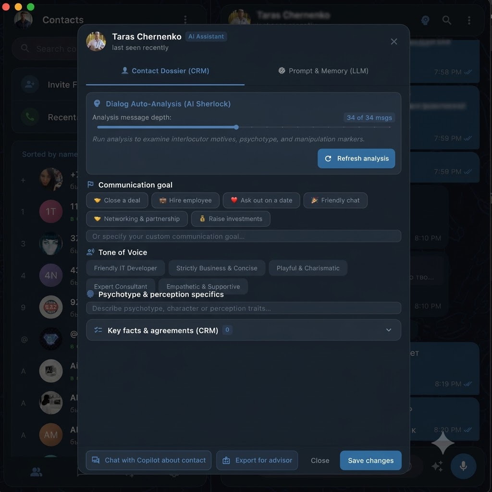
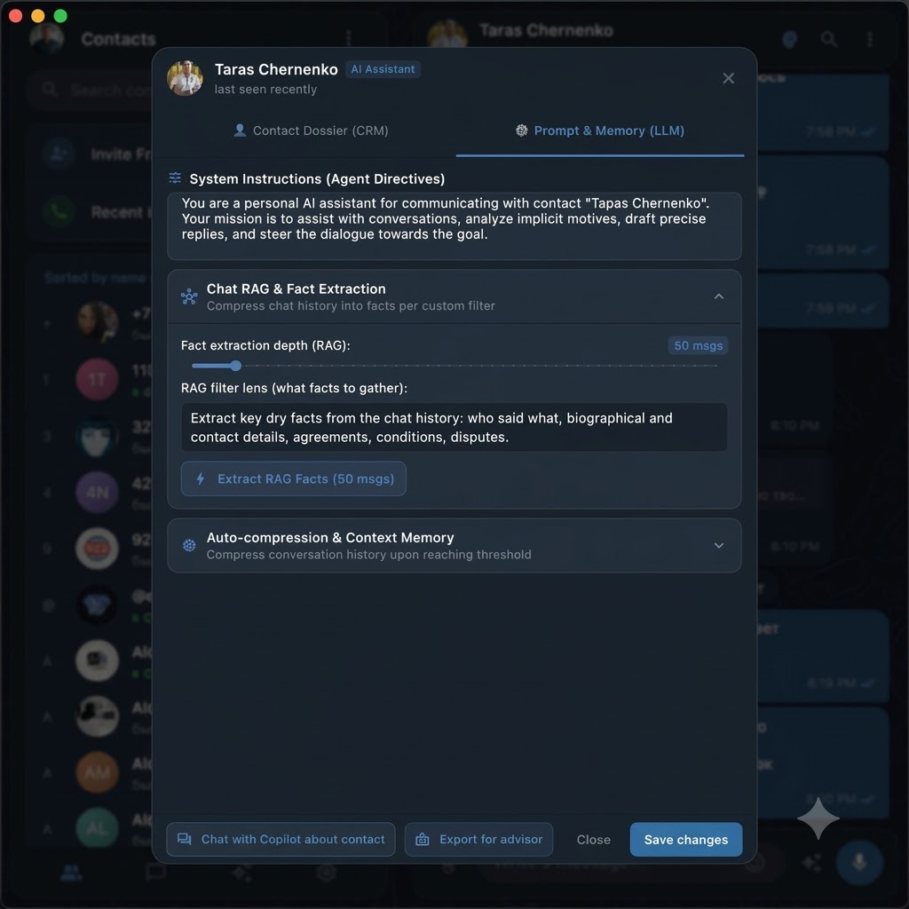
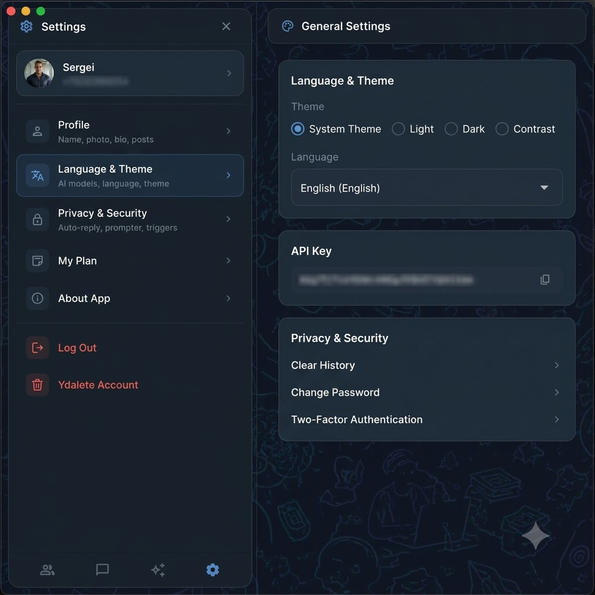

# 🚀 TellMeMore TG (TellMeMore Telegram Client)

<p align="center">
  <a href="README.md"><b>Русский</b></a> • <a href="README_EN.md"><b>English</b></a>
</p>

<p align="center">
  <a href="https://github.com/s3rfdev/TellMeMore_TG/releases/tag/v1.0.0"></a>
  
  
  
  
  
</p>

<p align="center">
  
</p>

<p align="center">
  <strong>Next-generation cross-platform Telegram client powered by an autonomous multi-agent AI brain for deep chat analysis, psychological participant profiling, manipulation detection, and strategic response drafting.</strong>
</p>

---

## 📸 Interface Screenshots

<div align="center">
  <table>
    <tr>
      <td width="50%">
        <br />
        <b>1. Telegram Client + Quick AI Actions Bar</b><br />
        <i>Full-featured messenger with one-tap "⚡ Auto-reply", "🎙 Dictate context", and "💬 Copilot chat" actions.</i>
      </td>
      <td width="50%">
        <br />
        <b>2. Contact-Specific AI Copilot Workspace</b><br />
        <i>Quick scenarios: "Analyze person & chat", "Is contact manipulating?", "Real motives", "Suggest reply".</i>
      </td>
    </tr>
    <tr>
      <td width="50%">
        <br />
        <b>3. Sherlock Analytical Engine</b><br />
        <i>Evaluates hidden ego traps, pragmatic proposal audits, and tactical advice toward communication goals.</i>
      </td>
      <td width="50%">
        <br />
        <b>4. Contact CRM Dossier & Tone of Voice</b><br />
        <i>Goal selection (Close deal, Hire, Networking, Date), Tone of Voice (IT, business, charismatic), psychotype traits.</i>
      </td>
    </tr>
    <tr>
      <td width="50%">
        <br />
        <b>5. Chat RAG Fact Extraction & Memory Compression</b><br />
        <i>Extracts dry facts from chat history (50+ msgs), custom system directives, and automatic dialogue compression.</i>
      </td>
      <td width="50%">
        <br />
        <b>6. Settings, Themes & Privacy</b><br />
        <i>System/Dark/Light theme switching, local encrypted API keys, 2FA, and strict local privacy.</i>
      </td>
    </tr>
  </table>
</div>

---

## 🌟 Key Features

### 🤖 Autonomous Multi-Agent AI Copilot
* **Multi-threaded Agent Sessions**: create dedicated copilots per contact (business assistant, chat profiler, HR recruiter, lead qualifier).
* **Sandwich Context Assembly**:
  1. *Top Layer*: system instructions, persona directives, role guardrails, and constraints.
  2. *Filling 1*: smart compressed summary of early dialogue history without losing critical terms or agreements.
  3. *Filling 2*: active sliding window of raw recent turns preserving exact phrasing and nuances.
  4. *Bottom Layer*: current user request, target CRM objectives, and response guidelines.
* **RAG Fact Extraction**: extracts dates, numbers, prices, agreements, objections, and hidden motives across dozens of messages in seconds.

### 🕵️ Sherlock Contact Dossier & CRM
* Automated background analysis of chat history.
* **Psychotype Classification** (Pragmatic, Analytical, Emotional, Conservative).
* **Manipulation Pattern Radar**: identifies passive aggression, bluffing, pressure, guilt-tripping, or subject evasion.
* Long-term **Communication Objective Tracking** (close deal, hire talent, raise investment, establish trust).
* **Goal-based AI Replies**: one-tap contextual responses tailored to the contact's psychological profile.

### 🎙️ Multimodal Capabilities: Audio & Vision
* **STT (Speech-to-Text)**: Deepgram Nova-2 and Whisper/Gemini STT for real-time voice message transcription and voice prompting.
* **Computer Vision**: automatic document, photo, and screenshot inspection with concise visual captions fed to LLM memory.

### 📱 Full Cross-Platform Architecture
* **Android**: touch gesture support, navigation Drawer, predictive back navigation (`PopScope`), background notifications (`POST_NOTIFICATIONS`, `WAKE_LOCK`).
* **macOS / Linux / Windows**: 3-column desktop layout, global system hotkeys, menu bar / tray integration, hardware-accelerated video (`media_kit`), graceful TDLib closing lifecycle.

### 🔒 Local Storage & Zero Telemetry
* All API credentials (Gemini, Zhipu GLM, OpenAI, Claude, Deepgram) are stored strictly on the user's local device.
* Copilot sessions, dossiers, and settings are saved using atomic disk transactions (`copilot_sessions.json`, `ai_settings.json`, `contact_dossiers.json`).
* TDLib runs in an isolated Dart isolate, guaranteeing that UI rendering stays at 60/120 FPS.

---

## 🌿 Branch Structure

To maintain clean releases across different operating systems, this repository uses the following branching workflow:

| Branch | Description |
| :--- | :--- |
| **`main`** | Stable multiplatform core codebase for all platforms. |
| **`android`** | Android UI adjustments, Gradle build scripts, permissions, APK / AAB artifacts. |
| **`macos`** | Xcode configs, CocoaPods, entitlements, sandbox settings, `.app` / `.dmg` builds. |
| **`linux`** | GTK3 runner, CMake configs, Linux media dependencies, AppImage/DEB packaging. |
| **`windows`** | Win32 runner configurations and Windows installer pipelines. |

Stable release builds are tagged with platform identifiers (e.g. `v1.0.0-android`, `v1.0.0-macos`, `v1.0.0-linux`).

---

## 🛠️ Build & Setup

### Prerequisites
* **Flutter SDK**: `>= 3.10.4`
* **Dart SDK**: `>= 3.10.4 < 4.0.0`
* Native **TDLib** binaries (`libtdjson`) for your target architecture.

### 1. Install Dependencies
```bash
flutter pub get
```

### 2. Run Tests
```bash
flutter test
```

### 3. Build Platforms

#### Android (APK)
```bash
flutter build apk --release
# Or debug build for connected test devices:
flutter build apk --debug
```

#### macOS (Bundle & Archive)
```bash
flutter build macos --release
```

#### Linux (Binary)
```bash
flutter build linux --release
```

---

## 👥 Authorship
Developed by **s3rfdev** (Sergei Fomenko). All rights reserved.
